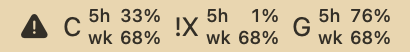
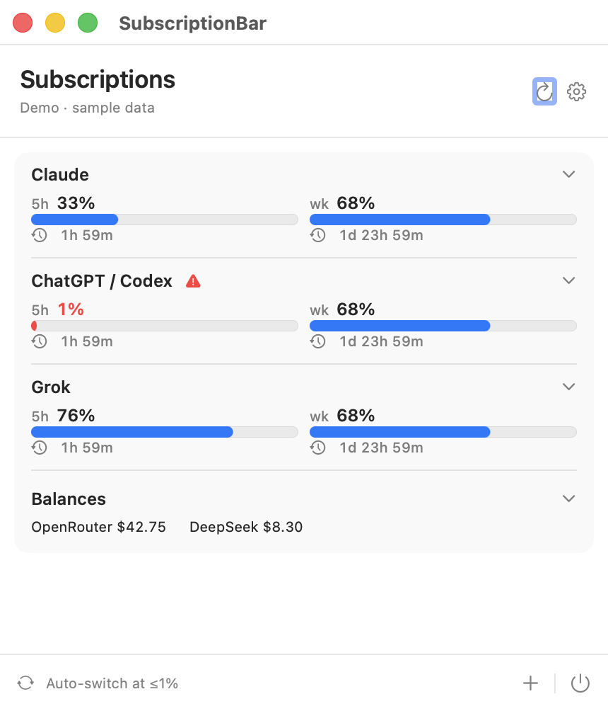
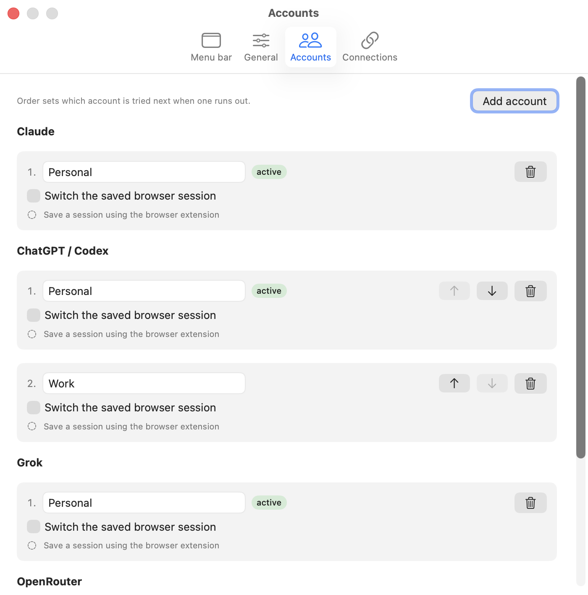
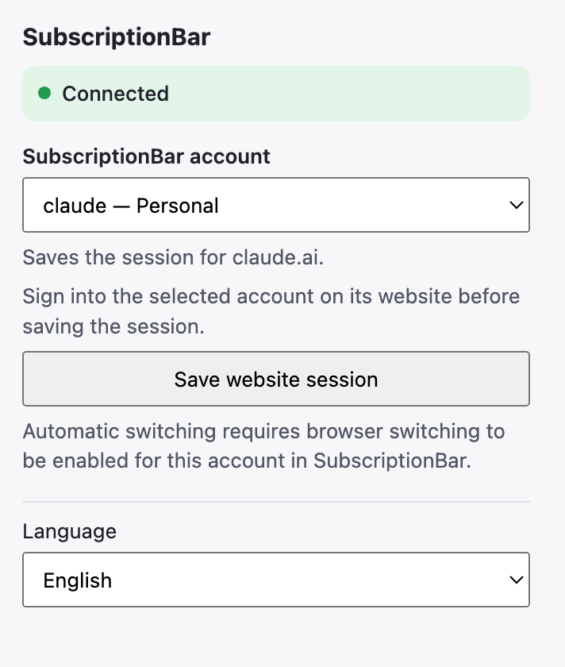
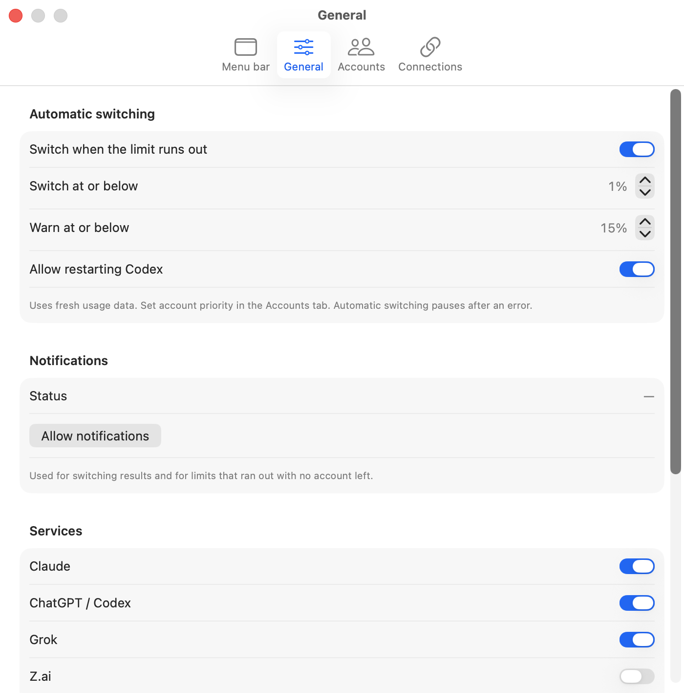

# SubscriptionBar

One macOS menu bar icon for the limits of every AI subscription you already pay for.

[](https://github.com/malakhov-dmitrii/subscriptionbar/actions/workflows/ci.yml)
[](LICENSE)


Русская версия: [README.ru.md](README.ru.md).
Screenshots below are demo mode (`--demo`): the data in them is invented.

<p align="center">
  
</p>

`C` is Claude, `X` is Codex, `G` is Grok. Numbers are what is **left**, not what
is used. A plan with both a 5-hour and a weekly limit shows both, labelled `5h`
on top and `wk` below; other services show their lowest remaining limit. A `!`
marks the service that is about to run out; the icon changes too, because macOS
renders menu bar text as a monochrome template and colour would be stripped.
When a service asks the app to slow down, the last numbers stay up, dimmed once
they are a few minutes old. `—` means there is no fresh reading.

<p align="center">
  
</p>

## What it does

- **Reads limits** for Claude Code, Codex and Grok CLI, plus optional Z.ai,
  OpenCode Go, Kimi Code, Cursor, OpenRouter and DeepSeek.
- **Switches accounts** for Claude, Codex and Grok when one runs out, using the
  priority you set. Every step is verified before and after it writes.
- **Stays local.** No server, no telemetry, no proxying of your requests.
  Credentials live in the macOS Keychain; the app talks only to each provider's
  own usage endpoint, plus a daily check of this repository's GitHub releases.
- **Updates itself on a click.** A new release shows **Update** in the window.
  It installs only if it is signed by the same developer and notarized by Apple.

## What it does not do

This list is the point, not a disclaimer. The project refuses to guess.

- A missing, malformed or out-of-range reading is **never** treated as zero, and
  never triggers a switch.
- Switching a native sign-in and switching browser cookies are not one atomic
  operation. On a partial result the app keeps the new native account, reports
  the browser failure and pauses automation.
- Codex gets a normal quit request. There is no force kill, and if the quit is
  declined or takes over 30 seconds the sign-in is not changed.
- A running CLI process may keep its old sign-in in memory. Task resumption
  after a switch is **not verified**.
- Claude Desktop, ChatGPT Desktop and Safari are not integrated.
- Applying saved cookies does not prove the website server accepted that account.
  The app says so instead of claiming success.

Every provider endpoint, its public source and its exact contract are documented
in [PROVIDER-SOURCES.md](PROVIDER-SOURCES.md).

## Install

Requires macOS 14 or later. No dependencies beyond the Swift toolchain.

```sh
git clone https://github.com/malakhov-dmitrii/subscriptionbar.git
cd subscriptionbar
SUBSCRIPTIONBAR_ADHOC=1 scripts/package-app.sh   # builds dist/SubscriptionBar.app
open dist/SubscriptionBar.app
```

`SUBSCRIPTIONBAR_ADHOC=1` signs the bundle ad-hoc, which is what you want when
building for yourself. Without it the script demands a Developer ID identity and
**refuses to fall back silently**: changing the signature invalidates the
Keychain trust an existing install already has, so that has to be a decision,
not a default. Set `SUBSCRIPTIONBAR_SIGNING_IDENTITY` to use your own certificate.

Packaging the Firefox companion needs Node.js; everything else is Swift only.

## Try it without touching anything

```sh
open dist/SubscriptionBar.app --args --demo
```

Demo mode uses sample data: no Keychain, no network, no files read or written.

```sh
open dist/SubscriptionBar.app --args --preview-only
```

Preview mode shows your real last-known readings with their age, and disables
Keychain, network and switching entirely.

## Connecting an account

1. Sign in to the client as usual (`claude`, `codex`, `grok`).
2. Press `+` in SubscriptionBar and save that account under a name.
3. Sign in to your **second** account in the same client, and save it too.

SubscriptionBar copies the credentials it finds into its own Keychain entry. It
never asks you to type a subscription password. API-key services take the key in
a secure field instead.

Claude Code's own Keychain item is read and written through `/usr/bin/security`,
the tool Claude Code itself uses. Claude Code rewrites that item on every token
refresh, which drops any access macOS granted to another app, so reading it
directly meant a new **Allow access** prompt every few hours. The token travels
over a pipe and never appears in process arguments.

The app follows `claude /login` on its own: the account Claude Code is signed
into becomes active, and an account it has not seen is saved under its email.
If that save fails, the Claude card offers **Connect** instead.

If macOS revokes access to SubscriptionBar's own vault, it pauses and shows
**Allow access**. One click reads only the exact failed item, then repeats the
read with interaction disabled before monitoring resumes. Cancelling does not
retry or replay the failed action.

Codex limits are read with each saved account's own credentials. Changing or
signing out of a client does not remove the other saved accounts or prevent
their usage requests. A revoked or genuinely expired saved login still requires
signing in again in Codex; a stored copy cannot extend its lifetime.

SubscriptionBar checks configured Codex data folders for newer credentials that
belong to a saved account. A changed OAuth subject requires matching ChatGPT user
and workspace claims in both ID/access tokens. Updated credentials must read
usage successfully before they replace the saved copy. The account keeps its ID
and settings; background polling never rewrites client files or exchanges saved
refresh tokens.

### Sign in again

For a saved Codex account with a login error, choose **Sign in again** on its
expanded card. The browser flow is the default; **Sign in with code** shows a
device code instead. Device login may need to be enabled in the ChatGPT account
or workspace settings. Both flows use the native CLI bundled with the installed
Codex application and an isolated temporary data folder.

After sign-in, SubscriptionBar checks the saved user and workspace and reads
fresh quota before updating the existing account. A different account is rejected.
The current client stays open unless you select **Switch in … after sign-in**;
that option installs the fresh login only in the selected profile. It also works
when that profile already has the same account with expired credentials. Cancel
is available before the save or native-switch step begins.

Claude Code captures use the account UUID, email and organization returned by
Anthropic for the captured token. Old `oauthAccount` metadata can make Claude's
`/status` display another email; it does not override that provider identity.
Capturing an account does not rewrite Claude Code's files. Saved switch targets
still require a matching provider identity before their credentials are applied.

### Several Codex clients

In Settings → Connections → Codex client profiles, give each client a name,
its data folder (`CODEX_HOME`) and the full path to its `.app`. Save the profiles,
then choose the target under **Switch in**. With multiple profiles, the expanded
Codex card also has a compact selector. A single profile needs no dashboard
selector; data paths are shown in Settings only. Existing single-client settings keep
their current data folder and registered Codex application.

The data folder must match the one that client actually uses. Renaming an app
to `codex2.app` does not create a separate data folder. Profiles sharing the same
folder, including symlink aliases, are rejected. Two instances may use the same
application when their separate data homes can be identified unambiguously.

Manual and automatic switches target only the selected profile. Selecting or
editing a profile preserves the existing automatic-switch setting. Saved accounts continue
to be polled independently; the active marker follows the selected client's
observed login. A signed-out or unrecognized login has no active saved account.
Removing a client profile leaves its files and saved accounts intact.

If an account is already signed in through another configured data home, select
that profile. SubscriptionBar refuses to copy its token into a second profile.

When several Codex profiles are configured, native switches leave browser
sessions unchanged. Browser cookies are saved per account and are not bound to
a native profile. Single-profile setups retain the optional browser-session
switch, including the existing browser account setting.

Native switching requires file-backed `auth.json`. Explicit `keyring`, `auto` and `ephemeral`
credential stores are unsupported. Ambiguous running instances stop the switch.
Multi-instance switching is tested with disposable fixtures; switching live user
accounts and resuming their tasks have not been verified end to end.

Accounts you have saved are listed in order of priority. That order is what
rotation follows when one runs out.

<p align="center">
  
</p>

For browser sessions, Settings → Connections walks through the three steps: run
the installer once, load the extension folder, then save a session per account.
The companion extension saves one website session per account.

These cookies are for browser sessions. Saving a ChatGPT browser session does
not capture or renew Codex native OAuth credentials. If a browser session expires,
sign in on the website and capture it again; if the native login expires, sign in
in Codex and save that account with `+`.

<p align="center">
  
</p>

## Automatic switching

- Triggers when a shared limit window drops to the configured threshold
  (1% by default, adjustable in Settings → General).
- A separate warning threshold (15% by default) colours the interface earlier
  without switching anything.
- Both the current and the next account need a successful reading under 90
  seconds old; the target is re-checked immediately before anything is written.
- The previous sign-in is saved first. Partial write failures roll back unless
  the client changed its own credentials meanwhile.
- After a switch there is a 120 second pause. After an error, automation stops
  and waits for you.

<p align="center">
  
</p>

## Development

```sh
scripts/verify.sh   # Swift tests, extension tests, syntax and script checks
swift build
swift test
```

The CI workflow runs exactly `scripts/verify.sh` on macOS.

Layout: `Sources/SubscriptionCore` holds the provider adapters, rotation policy,
Keychain vault and localization; `Sources/SubscriptionBar` holds the SwiftUI
interface; `browser-extension/` holds the Chrome extension, with the Firefox
build generated from the same sources by `build-firefox.mjs`.

## Security

Credential handling, threat model and reporting: [SECURITY.md](SECURITY.md).

## License

MIT — see [LICENSE](LICENSE).
